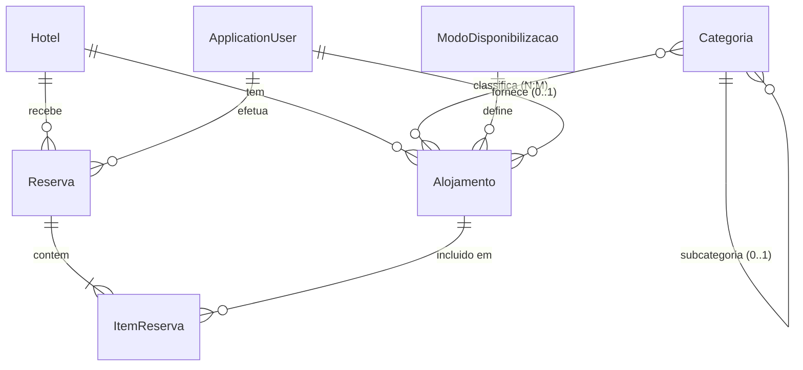

# Relatório do Trabalho Prático — MyHotels

**Unidade Curricular:** Programação Web (2026/2027 — 1º Semestre)  
**Instituição:** Instituto Superior de Engenharia de Coimbra (ISEC/IPC)  
**Autores:** *(Preencher com Nome Completo, Nº de Aluno, Ramo e Curso)*  

---

## 1. Introdução e Objetivos

O presente trabalho prático tem como objetivo o desenvolvimento da plataforma **MyHotels**, uma prova de conceito para a gestão e reserva de alojamentos (quartos e apartamentos) de uma cadeia de hotéis e aparthoteis, implementada com base no ecossistema **.NET 8** (ASP.NET Core Blazor Web, Blazor Hybrid / .NET MAUI, Razor Class Library, Web API RESTful, Entity Framework Core, ASP.NET Core Identity e JWT).

### Avaliação do Alcance dos Objetivos
*(A preencher continuamente à medida que as etapas forem concluídas.)*

---

## 2. Arquitetura da Solução

A solução é composta por quatro projetos em `MyHotels.sln` que partilham uma **única base de dados SQL Server LocalDB**:

1. **`MyHotels` (Backoffice — Blazor Web App / Interactive Server):** Aplicação exclusiva para Administradores e Funcionários, ligada diretamente à base de dados via `ApplicationDbContext` e LINQ.
2. **`RESTfulAPI` (Backend — ASP.NET Core Web API):** API RESTful com Swagger e Dev Tunnel que expõe os dados de forma controlada para os frontends públicos, utilizando Identity + JWT.
3. **`RCLMyHotels` (Razor Class Library):** Biblioteca partilhada com a interface gráfica única (sliders, catálogo, carrinho, reservas) e CSS comum.
4. **`MyHotelsWeb` (Blazor Web) & `MyHotelsMAUI` (Blazor Hybrid):** Aplicações hospedeiras que consomem a `RCLMyHotels` para Web e dispositivos nativos.

---

## 3. Modelo de Dados (MER)

### Entidades Principais
- **`Hotel`:** Hotéis e aparthoteis (`Id`, `Nome`, `Tipo`, `Estrelas`, `Localizacao`, `Descricao`, `Imagem`, `Ativo`).
- **`Categoria`:** Classificação dos alojamentos com suporte a subcategorias (`CategoriaPaiId`) e relação `N:M` com `Alojamento`.
- **`ModoDisponibilizacao`:** Define a modalidade do alojamento e se está disponível para reserva (`ParaReserva`) ou apenas para listagem.
- **`Alojamento`:** Quartos e apartamentos (`PrecoBase`, `PercentagemLucro`, `PrecoFinal`, `Stock`, `Disponivel`, `Ativo`, `CapacidadePessoas`, `Imagem`).
- **`Reserva` & `ItemReserva`:** Cabeçalho da reserva (associado a um único `Hotel` e a um `Cliente`) e respetivas linhas com quantidade e preço unitário histórico.
- **`ApplicationUser`:** Extensão de `IdentityUser` com `Nome`, `Apelido`, `NIF`, `Morada`, `Localidade`, `Estado` (`Pendente` / `Ativo`) e `DataRegisto`.

---

## 4. Regras de Negócio

*(Secção viva — atualizada a cada funcionalidade implementada.)*

1. **Unicidade de Hotel por Reserva:** Cada `Reserva` pode conter um ou mais alojamentos (e múltiplas unidades de cada), mas todos têm de pertencer a um único `Hotel` ou `Aparthotel`.
2. **Cálculo de Preço Final:** O `PrecoBase` é definido pelo fornecedor; o `PrecoFinal` apresentado ao cliente resulta da aplicação de uma percentagem de lucro (`PercentagemLucro`) no Backoffice.
3. **Alojamentos para Reserva vs. Só Listagem:** Apenas alojamentos cujo `ModoDisponibilizacao` tenha `ParaReserva = true`, estejam `Ativo = true`, `Disponivel = true` e com `Stock > 0` podem ser efetivamente reservados.
4. **Registo e Aprovação de Clientes:** Um novo utilizador registado no frontend público recebe o perfil `Cliente` no estado `Pendente`, só podendo passar a `Ativo` por ação de um `Funcionário` ou `Administrador` no Backoffice.
5. **Preservação de Histórico:** O `ItemReserva` guarda o `PrecoUnitario` no momento da reserva para que alterações futuras de preço não afetem reservas anteriores.
6. **Eliminação Segura:** Registos com dependências (ex.: alojamentos com reservas associadas) não devem ser apagados fisicamente, recorrendo-se à inativação lógica (`Ativo = false`).

---

## 5. Completude das Funcionalidades Implementadas

*(A preencher após conclusão de cada módulo: Backoffice, API, Frontend Web/MAUI.)*

---

## 6. Credenciais de Acesso (Utilizadores de Teste)

| Perfil / Role | Email / Username | Password | Estado |
| :--- | :--- | :--- | :--- |
| Administrador | `admin@myhotels.pt` | `Admin#123` | Ativo |
| Funcionário | `func@myhotels.pt` | `Func#123` | Ativo |
| Cliente | `cliente@myhotels.pt` | `Cliente#123` | Ativo |

---

## 7. Principais Dificuldades e Como Foram Superadas

- **Modelação de múltiplas categorias por alojamento e subcategorias:** Optou-se por uma relação `N:M` nativa em EF Core 8 entre `Alojamento` e `Categoria`, complementada por uma auto-referência opcional (`CategoriaPaiId`) em `Categoria`, permitindo classificar e filtrar alojamentos nos frisos deslizantes por múltiplos critérios sem duplicar registos.
- **Múltiplos caminhos de eliminação em cascata no SQL Server:** Como `ItemReserva` é alcançável a partir de `Hotel` tanto via `Alojamento` como via `Reserva`, o SQL Server rejeita múltiplos caminhos de `CASCADE DELETE`. Configurou-se `DeleteBehavior.Restrict` em `OnModelCreating`, resolvendo o erro e garantindo integridade referencial.
- **Referência `Microsoft.AspNetCore.App` numa RCL partilhada com MAUI:** O template inicial da `RCLMyHotels` incluía `<FrameworkReference Include="Microsoft.AspNetCore.App" />`, o que impedia a compilação do `MyHotelsMAUI` para `iossimulator-x64` e `maccatalyst-x64`. Substituiu-se pelo pacote multiplataforma `Microsoft.AspNetCore.Components.Web` e removeu-se o `NavMenu.razor` duplicado dos projetos hospedeiros.
- **Serialização JSON de entidades relacionadas na API:** Para devolver diretamente as entidades de domínio sem criar ciclos infinitos (ex.: `Hotel` ↔ `Alojamento`), configurou-se `ReferenceHandler.IgnoreCycles` nas opções JSON dos Controllers da `RESTfulAPI`.

---

## 8. Análise Autocrítica e Conclusão

*(A preencher na fase final do projeto.)*
